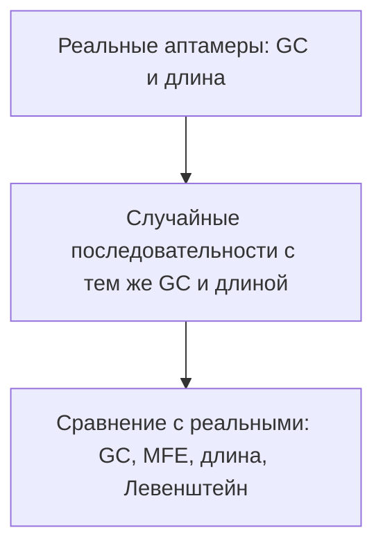
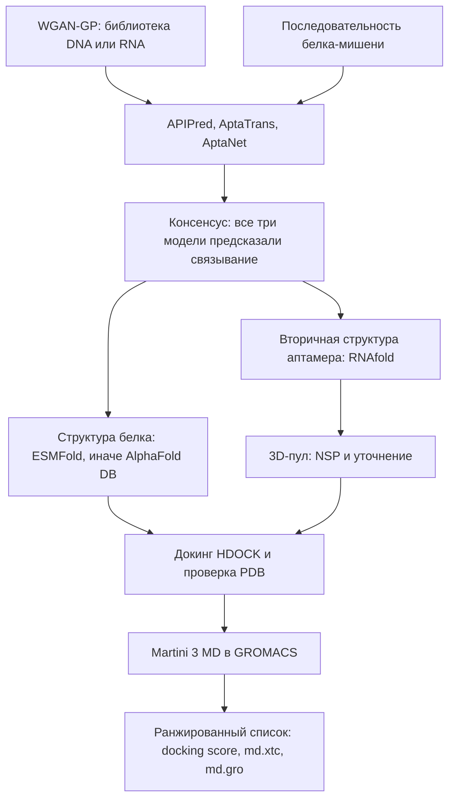

# ML System Design Doc

## Дизайн ML системы — in silico discovery аптамеров, MVP, итерация 1

Продукт — вычислительный пайплайн, который предлагает новые последовательности ДНК- и РНК-аптамеров и отбирает из них кандидатов на связывание с заданным белком до мокрого эксперимента.

### 1. Цели и предпосылки

#### 1.1. Зачем идем в разработку продукта?

Сейчас аптамеры ищут экспериментальным отбором SELEX: много раундов синтеза, отбора и секвенирования. Это долго и дорого, а большая часть библиотеки до белка-мишени не доходит.

Генератор предлагает новые последовательности, похожие на известные аптамеры по составу и локальным мотивам, но не копирующие их. Дальше in silico-валидация оставляет только те пары «аптамер — белок», которые проходят согласие трёх моделей связывания, структурную проверку, докинг и короткую молекулярную динамику.

Успех итерации для бизнеса: на выходе есть ранжированный короткий список кандидатов с docking score и артефактами MD. По этому списку можно решать, какие последовательности синтезировать. Сам синтез и измерение аффинности в пробирке в эту итерацию не входят.

#### 1.2. Бизнес-требования и ограничения

Нужно для заданной белковой мишени получить библиотеку химически правдоподобных ДНК- или РНК-последовательностей и упорядочить её по вычислительным признакам связывания. Пользователь пайплайна — исследователь, который приносит последовательность мишени и забирает таблицу кандидатов.

Ограничения по сложности реализации:

- Размеченных пар «аптамер — белок» мало. Негативы для скрининга приходится собирать синтетически: случайные сочетания известных аптамеров и белков, которых нет в положительной выборке, 3 негатива на 1 позитив. Это не экспериментально подтверждённые несвязывающие пары, и классификатор на них легко переоценить.
- Привязать генератор к белку в этой итерации слишком дорого: он учится только распределению последовательностей. Отбор под мишень вынесен в отдельный каскад валидации.
- ДНК и РНК не собираются в одну модель. Алфавиты разные: `{A, C, G, T, X}` и `{A, C, G, U, X}`, `X` — паддинг. Длина в генераторе фиксирована: 80 позиций, хвост из `X` отрезается.
- Структурный блок трудно собрать и прогнать. ViennaRNA, ESMFold или AlphaFold DB, RNAfold, NSP, HDOCK, GROMACS, martinize2 и reForge в репозитории нет, их ставят отдельно. Обучение генератора и production-MD упираются в GPU.
- Полноатомная динамика всего шортлиста неподъёмна по времени. В этой итерации MD coarse-grained, силовое поле Martini 3.

От итерации ожидается воспроизводимый прогон двух частей репозитория: `Aptamer-Generation` и `Aptamer-Validation`.

Как этим пользуются в процессе: исследователь указывает мишень, пайплайн отсекает слабых кандидатов и отдаёт таблицу. Человек выбирает, что нести в эксперимент. В этой итерации эксперимент не запускается.

Пилот успешен, если выдержаны пороги качества:

- На мишень в шортлисте не больше 5 кандидатов с лучшим docking score среди прошедших проверку PDB. По этому списку решают, что синтезировать.
- F1 0.70 и ROC AUC 0.80 для APIPred, AptaTrans и AptaNet — черновой порог отдельных моделей. Его не измеряли: тестовых CSV и `benchmark_summary.json` в репозитории нет, из статьи эти числа не взяты. Список на синтез ограничивает не этот порог, а не больше 5 кандидатов на мишень. Как этот список проверять, написано в этапе 2.
- Из комплексов, дошедших до проверки PDB, её проходят не меньше 80%: в структуре есть атомы, у белка больше 50 атомов, у РНК больше 20. В MD уходят только они.

Пути развития: условная генерация под конкретный белок, дообучение генератора наградой из MD, полноатомная динамика, синтез топ-кандидатов и проверка связывания in vitro.

#### 1.3. Что входит в скоуп проекта/итерации, что не входит

В эту итерацию входит:

- Обучение WGAN-GP для ДНК и РНК и генерация библиотеки последовательностей.
- Контроль генерации по GC-составу, MFE (ViennaRNA), средней длине и расстоянию Левенштейна до ближайшей реальной последовательности.
- Скрининг пар «аптамер — белок» тремя моделями: APIPred, AptaTrans, AptaNet. В консенсус попадает пара, только если все три предсказали класс «связывается».
- Структура белка (ESMFold, при неудаче — AlphaFold DB), вторичная структура аптамера (RNAfold), пул 3D-моделей (NSP и уточнение).
- Докинг HDOCK, проверка PDB (в комплексе есть атомы; белок больше 50 атомов, РНК больше 20) и coarse-grained MD в GROMACS.
- Сводные таблицы `candidates_for_docking.csv` и `final_ranked_candidates_hdock.csv`.

В эту итерацию не входит:

- Синтез и лабораторный анализ (EMSA, SPR).
- Обучение генератора на награду из docking score или MD.
- Генерация, обусловленная последовательностью белка.
- Полноатомная MD (AMBER/CHARMM).
- Сервис с API, очередью задач и SLA.

Код итерации — исследовательские скрипты и Snakemake, не устанавливаемый пакет. Стиль Python проверяют Ruff и pre-commit, правила лежат в `pyproject.toml` и описаны в `CONTRIBUTING.md`. Фиксированные сиды есть в генерации и в `preprocess_and_split.py` (`random_state=42`). Отдельного окружения со всеми научными бинарниками в репозитории нет.

Технический долг, который оставляем до продуктивизации:

- Сгенерированная библиотека и валидация ещё не склеены одним входом. Генератор пишет веса и отчёт в `Aptamer-Generation`. Валидация стартует с `Aptamers_and_targets.csv`, то есть с известных пар, а не с новых последовательностей.
- `Snakefile` не проходит Ruff: это Snakemake, не чистый Python.
- Внешние модели и бинарники ставятся вручную.
- Негативы для классификаторов — синтетические пары. Precision на таком негативном классе завышает реальную избирательность.

#### 1.4. Предпосылки решения

Единица решения — одна последовательность аптамера против одной белковой мишени. Система сокращает экспериментальный перебор перед синтезом.

Какие данные используем:

- Для генератора — последовательности реальных аптамеров, файлы `Aptamer-Generation/data/train_dna_dataset.csv` и `train_rna_dataset.csv`. Модель учится распределению последовательностей, отдельной метки связывания у генератора нет.
- Для скрининга — пары `apt_seq`, `target_seq` и имя мишени. Позитивная пара — известное связывание. Негативная пара собирается случайным сочетанием аптамера и белка, которого нет среди позитивов. РНК и ДНК делятся по наличию `U` в последовательности аптамера.
- Для структуры и динамики — аминокислотная последовательность мишени, последовательность аптамера, вторичная структура в dot-bracket, PDB комплекса.

Гранулярность моделей разная, и это заложено в схему:

- Генератор выдаёт последовательность до 80 символов из шума размерности 64. Он не знает мишень.
- Три модели скрининга оценивают пару целиком и отдают вероятность класса «связывается».
- Докинг и MD оценивают уже конкретную 3D-конформацию этой пары. У одного аптамера несколько конформеров, у каждого свой docking score.

Порог консенсуса жёсткий: внутреннее пересечение положительных предсказаний трёх моделей. Одна уверенная модель кандидата в докинг не пропускает. Так мы меняем полноту на меньший список для дорогих структурных шагов.

### 2. Методология

#### 2.1. Постановка задачи

Система решает две связанные задачи.

1. Генерация. Генерация дискретных последовательностей. WGAN-GP с градиентным штрафом (`λ = 10`), сэмплирование через Gumbel-Softmax, штраф за расхождение частот 2-меров и 3-меров (`α = 2`, `β = 5`) и энтропийная регуляризация (`γ = 0.05`). Критик оценивает расстояние между реальными и сгенерированными последовательностями.
2. Отбор под мишень. Каскад фильтров: классификация связывания, затем ранжирование структур. Классификаторы сравниваются по accuracy, ROC AUC, precision, recall и F1 класса «связывается». В структурном блоке кандидат ранжируется по docking score HDOCK. В MD уходит только комплекс, прошедший проверку PDB.

Бейзлайн — простой референс, с которым сравнивают генератор: случайные последовательности с тем же GC-составом и той же длиной, что у реальных аптамеров. Сравнение идёт по GC, MFE, длине и расстоянию Левенштейна до ближайшей реальной последовательности. WGAN-GP в бейзлайн не входит.

MVP — WGAN-GP плюс отбор под мишень: консенсус трёх моделей, фолдинг, докинг и Martini 3 MD. F1 0.70 и ROC AUC 0.80 — черновые пороги отдельных моделей, их ещё нет в `benchmark_summary.json`. На мишень в шортлист попадает не больше 5 кандидатов, прошедших проверку PDB.

#### 2.2. Блок-схема решения

Бейзлайн — случайные последовательности без модели и без белка. MVP начинается с WGAN-GP и добавляет отбор под мишень.

Бейзлайн:

MVP, генерация плюс `Aptamer-Validation`:

Порядок MVP совпадает с шестью блоками `Aptamer-Validation`: скрининг и консенсус, фолдинг белка, вторичная структура, 3D-модель аптамера, докинг, coarse-grained MD. Сводка докинга пишется в `final_ranked_candidates_hdock.csv`. Траектория и финальная структура MD — `md.xtc` и `md.gro`.

#### 2.3. Этапы решения задачи

Цифры ниже из таблиц репозитория. Ноутбук `eda/aptamer_eda.ipynb`, скрипт `eda/run_eda.py`, сводка `eda/eda_summary.json`, картинки в `eda/figures/`.

##### Этап 1. Подготовка данных

Генератор видит уникальную последовательность аптамера. Скрининг видит пару "аптамер - белок" и метку: 1, если пара связывается, 0 если нет. Докинг и MD видят уже 3D-конформер этой пары.

| Данные | Где лежат | Откуда брать | Качество проверено |
| --- | --- | --- | --- |
| Пары DNA: `apt_seq`, `target_seq`, `label` | `Aptamer-Generation/data/train_dna_dataset.csv`, 2486 строк | статический файл в репозитории | да, этот EDA |
| Пары RNA | `train_rna_dataset.csv`, 1804 строки | статический файл в репозитории | да, этот EDA |
| Шортлист консенсуса | `Aptamer-Validation/docking_candidates/candidates_for_docking.csv` | прогон трех моделей скрининга | да, первая строка файла битая |
| Docking score | `docking_results/final_ranked_candidates_hdock.csv` | прогон HDOCK | да |
| Исходный каталог `Aptamers_and_targets.csv` | в репозитории нет | нужен скрипту `preprocess_and_split.py` | нет |
| Тестовые CSV после CD-HIT | скрипт пишет `test_dna_dataset.csv` и `test_rna_dataset.csv`, файлов нет | повторный запуск подготовки | нет |

Что в обучающих таблицах:

| | DNA | RNA |
| --- | ---: | ---: |
| Строк | 2486 | 1804 |
| Уникальных аптамеров | 285 | 286 |
| Уникальных белков | 335 | 333 |
| Метка 1 | 839 | 186 |
| Метка 0 | 1647 | 1618 |

Пустых последовательностей нет, дублей пар нет, одной и той же пары с двумя метками тоже нет. Белки записаны обычными аминокислотами. DNA-аптамеры состоят из A, C, G, T.

Что видно по таблицам, а не только по средним:

- Позитивные RNA-пары сидят на 42 белках. Еще 291 белок встречается только с меткой 0: это 1420 строк из 1804. На оставшихся 384 строках доля метки 1 равна 0.484. Если оценку пары заменить на долю позитивов этого белка по остальным его строкам, ROC AUC на всей RNA-таблице равен 0.927, а на этих 384 строках падает до 0.617. Длина и GC эти 1420 строк почти не отличают от позитивов: средняя длина 51.49 против 50.56, GC 0.532 против 0.526. Легкими их делает белок, у которого в таблице нет ни одного позитива, а не вид последовательности.
- У DNA по строкам длина и GC выглядят разделяющими: ROC AUC 0.772 и 0.685, средние 74.8 против 52.4 и 0.574 против 0.525. По уникальным аптамерам это пропадает: AUC длины 0.502, AUC GC 0.426. Средняя длина уникального аптамера с позитивом 54.3, без позитива 51.3. Разрыв в строках появляется потому, что длинные аптамеры повторены во многих позитивных парах. У RNA AUC длины и GC по строкам уже 0.493 и 0.475. Асимметрия DNA/RNA здесь артефакт повторов строк, не свойство связывания и не отдельный сдвиг GC у синтетических негативов.
- В `preprocess_and_split.py` задумано 3 синтетических негатива на 1 позитив. В файлах репозитория вышло 1.96 у DNA и 8.70 у RNA. Эти нули никто не проверял в лаборатории. Метрики на них и лабораторную проверку считаем отдельно.
- Генератор режет последовательность до 80 символов. Длиннее 115 DNA-строк и 179 RNA-строк.
- Белок длиннее 1000 аминокислот у 1381 DNA-пар и у 895 RNA-пар. ESMFold на таких часто не проходит, тогда берем AlphaFold DB.
- 21 DNA-аптамер без G и C, 20 из них с меткой 0. В RNA-таблице 42 строки с буквой T, хотя DNA/RNA делится по наличию U. 41 из них - негативы. `rna_seq_gen.py` такие последовательности выкидывает: из обучения уходит 6 уникальных RNA-аптамеров, остается 280. У DNA буквы U нет, генератор берет все 285.
- У DNA 138 аптамеров из 285 ни разу не помечены как связывающие. Это 48% обучающих последовательностей генератора, 837 строк. Средняя длина 51.26 против 54.30 у тех, у кого позитив был, GC 0.540 против 0.511. У RNA без фильтра по T таких 100 из 286, после выкидывания T остается 95 из 280. Длина 52.47 против 50.34, GC 0.549 против 0.526. Косинус 3-меров между двумя пулами 0.969 у DNA и 0.972 у RNA: состав почти тот же, сдвига мотивов почти нет. Масштаб другой: в генератор все равно попадает почти половина DNA-последовательностей, у которых связывания в таблице нет.
- Близких копий немного. Медианный косинус 3-меров до ближайшего другого аптамера 0.771 у DNA и 0.745 у RNA. При пороге 0.9 получается 17 кластеров DNA (49 аптамеров, самый большой 10) и 15 кластеров RNA (47 аптамеров, самый большой 6).
- В шортлисте 29 пар. Первая строка файла - текст `cat candidates_for_docking.csv`, не заголовок. У двух строк нет имени мишени и `true_label = 0`. Вероятности APIPred и AptaTrans везде 1.0. В докинге 123 модели и 25 кандидатов, четырех кандидатов в таблице нет. Медиана docking score -396.27. Лучший score не выше -1000 только у трех кандидатов.

Новизна текущего шортлиста, если смотреть пересечение с train, а не `true_label`:

| Срез | Строк | Что это |
| --- | ---: | --- |
| Аптамер и мишень уже были | 18 | не проверка обобщения; здесь же обе строки с `true_label = 0` |
| Аптамер был, мишень новая | 1 | проверка на новой мишени |
| Аптамер новый, мишень была | 8 | проверка новизны аптамера |
| Новы оба | 2 | единственные строки, где новы и последовательность, и белок |

19 строк с уже виденным аптамером - это 18 плюс 1. Для синтеза такой список не годится: он собран из пар с меткой, а не из сгенерированных последовательностей.

Откуда данные. Регулярной поставки нет. Каталог пар кладется один раз. `preprocess_and_split.py` оставляет уникальные пары как позитивы, добирает негативы случайными сочетаниями, делит DNA и RNA по букве U и режет train/test кластерами CD-HIT. Генератор потом читает готовый train CSV и берет уникальные последовательности. Шортлист и docking score - результат одного прогона валидации. Исходного каталога и тестовых CSV в репозитории нет, поэтому это разбиение из текущих файлов не повторить.

RNA-позитивов 186, DNA-позитивов 839. Чтобы RNA догнала DNA по числу позитивов, не хватает примерно 650 подтвержденных пар. Этого мало, пока нет лабораторных негативов: сейчас все нули синтетические. Новые нули берем на тех же белках, где позитивы уже есть. Случайный новый белок без единого позитива снова даст легкую строку, как 1420 RNA-строк выше.

Имен, контактов и историй пациентов в таблицах нет. Есть последовательности и названия мишеней, в том числе вирусные белки. Обезличивать нечего. На выходе все равно расчетный список для исследователя, не медицинское заключение.

Результат этапа - проверенные train-таблицы и ноутбук `eda/aptamer_eda.ipynb`. На честную проверку скрининга идут белки, у которых в данных есть обе метки. В генератор не кладем строки с чужим алфавитом. Белки длиннее 1000 аминокислот помечаем как риск для фолдинга. Шортлист читаем со строки заголовка `apt_seq`, первую битую строку пропускаем.

Для бейзлайна метка пары не нужна: случайные последовательности строятся по GC и длине реальных аптамеров. Для MVP нужны и уникальные аптамеры (WGAN-GP), и пары с меткой (три модели скрининга). Лабораторная проверка в этот этап не входит.

##### Этап 2. Подготовка прогнозных моделей

Генерация последовательности и оценка пары - разные модели. У них разные потери, разные выборки и разные метрики. F1 и ROC AUC трех моделей скрининга в репозитории не посчитаны: нет тестовых CSV и нет `benchmark_summary.json`. Числа 0.70 и 0.80 ничем здесь не подтверждены и из описания проекта не взяты. Это черновой порог "модель не сломана", не критерий топ-5.

**Бейзлайн, уже посчитан.** Для каждого уникального аптамера, который реально идет в генератор (DNA: 285, RNA: 280 после отбрасывания строк с T), построена случайная строка той же длины и с тем же числом G и C. GC и длина совпали с реальными: DNA 0.525 и 52.83, RNA 0.534 и 51.06. Это проверка сэмплера. Среднее минимальное расстояние Левенштейна до ближайшей реальной последовательности: 24.59 у DNA и 23.70 у RNA. Медиана 19 и 20. MFE для этих случайных строк в этом прогоне не считался. F1 у бейзлайна нет, метки связывания у него нет.

**Генератор, что есть в логе.** WGAN-GP, как в модуле генерации. Потеря критика - расстояние Вассерштейна и градиентный штраф, `λ = 10`. Потеря генератора - минус оценка критика, MSE частот 2-меров и 3-меров (`α = 2`, `β = 5`) и минус энтропия (`γ = 0.05`). В `training_results` на эпохе 199, те же числа, что в описании проекта: DNA GC 0.540 при 0.525 у реальных, длина 42.58 при 52.83, MFE -8.43 при -12.13, Левенштейн 20.02. RNA GC 0.527 при 0.534, длина 45.50 при 51.06, MFE -8.27 при -10.54, Левенштейн 21.24. Таблица в корневом README чуть другая (DNA Левенштейн 20.15, RNA 21.96) и к этой эпохе не привязана. Оба отчета сняты внутри обучения, на тех же реальных последовательностях, не на отложенных. Левенштейн 20 близок к случайному бейзлайну (24.6 и 23.7), но сгенерированные строки короче на 10 и 6 нуклеотидов, и часть расстояния - просто разница длин. Отложенный отчет генератора все еще нужен. MFE бейзлайна к этим -8.43 и -8.27 пока не с чем сравнить.

**Скрининг, что проверено без трех моделей.** APIPred, AptaTrans и AptaNet в текущем прогоне не перезапускались. AptaNet в коде считается через XGBoost, не через исходную нейросеть. По таблицам проверено другое. Один белок без аптамера: на полной RNA ROC AUC 0.927, на белках с обеими метками 0.617. На DNA тот же счет дает 0.424 и 0.333, то есть "запомнит белок" для DNA по этим строкам не подтверждается, для RNA подтверждается в основном легкими негативами. Длина и GC как единственный признак: см. этап 1. Accuracy порогом не ставим.

**Как устроен отдельный прогон и как выбирается топ-5.** Горизонта по времени нет. `run_benchmarks_and_consensus.py` сейчас читает train и test, считает три модели на `test_df` и оставляет пересечение строк, где все три предсказали класс 1. Потом подставляет `label` этого же test в колонку `true_label`. Для сгенерированных пар метки нет, поэтому список на синтез из этого скрипта так не собрать: `true_label` в отборе не участвует.

Прогон на новых кандидатах выглядит так. На вход таблица пар без обязательной метки: сгенерированный аптамер и белок. Модели считают вероятность. Строки режем на четыре среза по пересечению с train: оба уже были, новая только мишень, новый только аптамер, новы оба. Там, где метка есть, для каждого среза отдельно считаем precision@5 и долю мишеней, у которых в пятерке вообще есть кандидат. Рядом те же два числа для ранжирования только по AptaNet, без требования, чтобы APIPred и AptaTrans тоже сказали "да". Пятерка - это бюджет синтеза из постановки проекта, не оптимум F1. Порог отдельных моделей 0.70 и 0.80 оставляем черновым, пока не появится `benchmark_summary.json`. Если на отложенном срезе одна модель дает precision@5 не хуже консенсуса, в докинг идет она: на текущем шортлисте APIPred и AptaTrans и так равны 1.0, и консенсус ничего сверх AptaNet не отсекает.

Лабораторный SPR или EMSA в эту таблицу не пишется. Это отдельный результат после синтеза.

**Где счет врет.** Синтетические нули на новых белках завышают RNA-метрику: это уже видно по AUC 0.927 против 0.617. Повторы длинных DNA-аптамеров раздувают средний разрыв длины. Насыщенные вероятности превращают консенсус в одну модель. Генератор, сверенный только с обучающими строками, нельзя считать проверенным на новых аптамерах.

Результат этапа, которого в репозитории пока нет: `benchmark_summary.json` с F1 и `roc_auc` трех моделей и тот же отчет генератора на отложенных аптамерах. Результат, который уже есть: случайный бейзлайн в `eda/eda_summary.json` и лог эпохи 199.

##### Этап 3. Консенсус под мишень

У случайного бейзлайна белка нет, поэтому на этом шаге он не участвует.

Правило консенсуса в коде - внутреннее пересечение трех положительных предсказаний. На файле `candidates_for_docking.csv` оно не работает как задумано: APIPred и AptaTrans дают 1.0 всем 29 строкам, минимальная вероятность AptaNet 0.645. Фактически список отсортирован одной моделью. Две строки без имени мишени имеют `true_label = 0`, в структуру их не кладем. Первую битую строку файла пропускаем.

Пока две вероятности насыщены, порог "все три сказали да" не обосновывает топ-5. Обоснование другое: не больше пяти кандидатов на мишень, и этот список сравнивается с топ-5 одной AptaNet по precision@5 и по доле мишеней с найденным кандидатом. На текущих 29 строках precision@5 посчитать нельзя. Почти все `true_label` равны 1, а пары, которые модели отвергли, в файл не попали. Долю мишеней с кандидатом по этому файлу тоже не оценить: мишени без кандидата сюда не записаны.

Отдельные срезы для этого файла уже посчитаны выше: 18, 1, 8 и 2. Список на синтез собираем заново из сгенерированных пар и раскладываем по тем же четырем срезам. Текущие 29 строк остаются отчетом старого прогона, не списком на синтез.

Результат этапа: `candidates_for_docking.csv` только как архив этого прогона. Для нового прогона - таблица сгенерированных пар без `true_label` и четыре среза новизны.

##### Этап 4. Структура, докинг и шортлист для синтеза

Для каждой пары, которая прошла этап 3: структура белка через ESMFold, если не вышло - AlphaFold DB; вторичная структура аптамера через RNAfold; пул 3D-моделей через NSP; докинг HDOCK; проверка PDB; для прошедших - Martini 3 MD в GROMACS.

По текущим данным примерно половина белков длиннее 1000 аминокислот, так что отказ ESMFold будет частым. Из 29 кандидатов старого консенсуса до таблицы докинга дошли 25, по 3-9 конформеров, всего 123 модели. Четыре кандидата отвалились раньше. Docking score от -1246.21 до -244.95, медиана -396.27. В MD попадает комплекс, где есть атомы, белок больше 50 атомов и РНК больше 20. Порог пилота: так проходят не меньше 80% задоченных комплексов.

Именных мишеней в шортлисте 10, у двух строк имени нет. Больше пяти кандидатов только у двух мишеней: E.Coli rho, 7 строк, и gp120, 6. У восьми мишеней, где докинг есть, пересечение топ-5 по AptaNet и топ-5 по лучшему docking score в среднем 0.917. У rho и gp120 пересечение 0.667, у остальных шести с докингом списки совпали. У EFTuGDP и RB69 RegA докинга нет, сравнивать нечего. Это сравнение старого файла, не метрика качества. В отчете нового прогона оба порядка обязательны: топ-5 по AptaNet и топ-5 по docking score.

Случайные последовательности в докинг не идут. Docking score и короткая Martini-траектория - не лабораторная аффинность. Длинный белок может выпасть на фолдинге, и шортлист станет короче. Синтез и SPR или EMSA идут после этого списка и в расчетные метрики не подмешиваются.

Результат этапа: `final_ranked_candidates_hdock.csv`, для прошедших PDB - `md.xtc` и `md.gro`, и не больше 5 кандидатов на мишень из сгенерированных пар.
