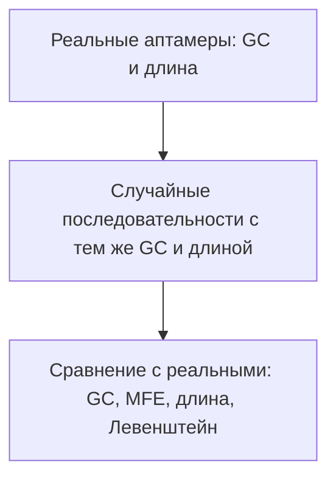
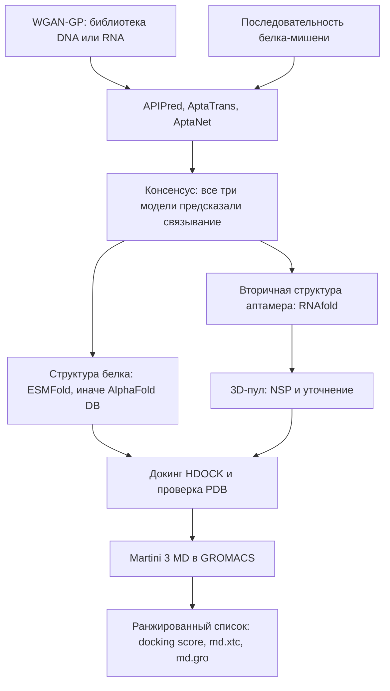

# ML System Design Doc

## Дизайн ML системы — in silico discovery аптамеров, MVP, итерация 1

Продукт — вычислительный пайплайн, который предлагает новые последовательности ДНК- и РНК-аптамеров и отбирает из них кандидатов на связывание с заданным белком до мокрого эксперимента.

### 1. Цели и предпосылки

#### 1.1. Зачем идем в разработку продукта?

Сейчас аптамеры ищут экспериментальным отбором SELEX: много раундов синтеза, отбора и секвенирования. Это долго и дорого, а большая часть библиотеки до белка-мишени не доходит.

Генератор предлагает новые последовательности, похожие на известные аптамеры по составу и локальным мотивам, но не копирующие их. Дальше in silico-валидация оставляет только те пары «аптамер — белок», которые проходят согласие трёх моделей связывания, структурную проверку, докинг и короткую молекулярную динамику.

Успех итерации для бизнеса: на выходе есть ранжированный короткий список кандидатов с docking score и артефактами MD. По этому списку можно решать, какие последовательности синтезировать. Сам синтез и измерение аффинности в пробирке в эту итерацию не входят.

#### 1.2. Бизнес-требования и ограничения

Нужно для заданной белковой мишени получить библиотеку химически правдоподобных ДНК- или РНК-последовательностей и упорядочить её по вычислительным признакам связывания. Пользователь пайплайна — исследователь, который приносит последовательность мишени и забирает таблицу кандидатов.

Ограничения по сложности реализации:

- Размеченных пар «аптамер — белок» мало. Негативы для скрининга приходится собирать синтетически: случайные сочетания известных аптамеров и белков, которых нет в положительной выборке, 3 негатива на 1 позитив. Это не экспериментально подтверждённые несвязывающие пары, и классификатор на них легко переоценить.
- Привязать генератор к белку в этой итерации слишком дорого: он учится только распределению последовательностей. Отбор под мишень вынесен в отдельный каскад валидации.
- ДНК и РНК не собираются в одну модель. Алфавиты разные: `{A, C, G, T, X}` и `{A, C, G, U, X}`, `X` — паддинг. Длина в генераторе фиксирована: 80 позиций, хвост из `X` отрезается.
- Структурный блок трудно собрать и прогнать. ViennaRNA, ESMFold или AlphaFold DB, RNAfold, NSP, HDOCK, GROMACS, martinize2 и reForge в репозитории нет, их ставят отдельно. Обучение генератора и production-MD упираются в GPU.
- Полноатомная динамика всего шортлиста неподъёмна по времени. В этой итерации MD coarse-grained, силовое поле Martini 3.

От итерации ожидается воспроизводимый прогон двух частей репозитория: `Aptamer-Generation` и `Aptamer-Validation`.

Как этим пользуются в процессе: исследователь указывает мишень, пайплайн отсекает слабых кандидатов и отдаёт таблицу. Человек выбирает, что нести в эксперимент. В этой итерации эксперимент не запускается.

Пилот успешен, если выдержаны пороги качества:

- На мишень в шортлисте не больше 5 кандидатов с лучшим docking score среди прошедших проверку PDB. По этому списку решают, что синтезировать.
- У APIPred, AptaTrans и AptaNet на тестовой выборке F1 класса «связывается» не ниже 0.70 и ROC AUC не ниже 0.80. В консенсус входит пара, которую связыванием назвали все три модели.
- Из комплексов, дошедших до проверки PDB, её проходят не меньше 80%: в структуре есть атомы, у белка больше 50 атомов, у РНК больше 20. В MD уходят только они.

Пути развития: условная генерация под конкретный белок, дообучение генератора наградой из MD, полноатомная динамика, синтез топ-кандидатов и проверка связывания in vitro.

#### 1.3. Что входит в скоуп проекта/итерации, что не входит

В эту итерацию входит:

- Обучение WGAN-GP для ДНК и РНК и генерация библиотеки последовательностей.
- Контроль генерации по GC-составу, MFE (ViennaRNA), средней длине и расстоянию Левенштейна до ближайшей реальной последовательности.
- Скрининг пар «аптамер — белок» тремя моделями: APIPred, AptaTrans, AptaNet. В консенсус попадает пара, только если все три предсказали класс «связывается».
- Структура белка (ESMFold, при неудаче — AlphaFold DB), вторичная структура аптамера (RNAfold), пул 3D-моделей (NSP и уточнение).
- Докинг HDOCK, проверка PDB (в комплексе есть атомы; белок больше 50 атомов, РНК больше 20) и coarse-grained MD в GROMACS.
- Сводные таблицы `candidates_for_docking.csv` и `final_ranked_candidates_hdock.csv`.

В эту итерацию не входит:

- Синтез и лабораторный анализ (EMSA, SPR).
- Обучение генератора на награду из docking score или MD.
- Генерация, обусловленная последовательностью белка.
- Полноатомная MD (AMBER/CHARMM).
- Сервис с API, очередью задач и SLA.

Код итерации — исследовательские скрипты и Snakemake, не устанавливаемый пакет. Стиль Python проверяют Ruff и pre-commit, правила лежат в `pyproject.toml` и описаны в `CONTRIBUTING.md`. Фиксированные сиды есть в генерации и в `preprocess_and_split.py` (`random_state=42`). Отдельного окружения со всеми научными бинарниками в репозитории нет.

Технический долг, который оставляем до продуктивизации:

- Сгенерированная библиотека и валидация ещё не склеены одним входом. Генератор пишет веса и отчёт в `Aptamer-Generation`. Валидация стартует с `Aptamers_and_targets.csv`, то есть с известных пар, а не с новых последовательностей.
- `Snakefile` не проходит Ruff: это Snakemake, не чистый Python.
- Внешние модели и бинарники ставятся вручную.
- Негативы для классификаторов — синтетические пары. Precision на таком негативном классе завышает реальную избирательность.

#### 1.4. Предпосылки решения

Единица решения — одна последовательность аптамера против одной белковой мишени. Система сокращает экспериментальный перебор перед синтезом.

Какие данные используем:

- Для генератора — последовательности реальных аптамеров, файлы `Aptamer-Generation/data/train_dna_dataset.csv` и `train_rna_dataset.csv`. Модель учится распределению последовательностей, отдельной метки связывания у генератора нет.
- Для скрининга — пары `apt_seq`, `target_seq` и имя мишени. Позитивная пара — известное связывание. Негативная пара собирается случайным сочетанием аптамера и белка, которого нет среди позитивов. РНК и ДНК делятся по наличию `U` в последовательности аптамера.
- Для структуры и динамики — аминокислотная последовательность мишени, последовательность аптамера, вторичная структура в dot-bracket, PDB комплекса.

Гранулярность моделей разная, и это заложено в схему:

- Генератор выдаёт последовательность до 80 символов из шума размерности 64. Он не знает мишень.
- Три модели скрининга оценивают пару целиком и отдают вероятность класса «связывается».
- Докинг и MD оценивают уже конкретную 3D-конформацию этой пары. У одного аптамера несколько конформеров, у каждого свой docking score.

Порог консенсуса жёсткий: внутреннее пересечение положительных предсказаний трёх моделей. Одна уверенная модель кандидата в докинг не пропускает. Так мы меняем полноту на меньший список для дорогих структурных шагов.

### 2. Методология

#### 2.1. Постановка задачи

Система решает две связанные задачи.

1. Генерация. Генерация дискретных последовательностей. WGAN-GP с градиентным штрафом (`λ = 10`), сэмплирование через Gumbel-Softmax, штраф за расхождение частот 2-меров и 3-меров (`α = 2`, `β = 5`) и энтропийная регуляризация (`γ = 0.05`). Критик оценивает расстояние между реальными и сгенерированными последовательностями.
2. Отбор под мишень. Каскад фильтров: классификация связывания, затем ранжирование структур. Классификаторы сравниваются по accuracy, ROC AUC, precision, recall и F1 класса «связывается». В структурном блоке кандидат ранжируется по docking score HDOCK. В MD уходит только комплекс, прошедший проверку PDB.

Бейзлайн — простой референс, с которым сравнивают генератор: случайные последовательности с тем же GC-составом и той же длиной, что у реальных аптамеров. Сравнение идёт по GC, MFE, длине и расстоянию Левенштейна до ближайшей реальной последовательности. WGAN-GP в бейзлайн не входит.

MVP — WGAN-GP плюс отбор под мишень: консенсус трёх моделей, фолдинг, докинг и Martini 3 MD. Целевые значения на тестовой выборке: F1 класса «связывается» не ниже 0.70 и ROC AUC не ниже 0.80 у каждой из трёх моделей. На мишень в шортлисте не больше 5 кандидатов, прошедших проверку PDB.

#### 2.2. Блок-схема решения

Бейзлайн — случайные последовательности без модели и без белка. MVP начинается с WGAN-GP и добавляет отбор под мишень.

Бейзлайн:

MVP, генерация плюс `Aptamer-Validation`:

Порядок MVP совпадает с шестью блоками `Aptamer-Validation`: скрининг и консенсус, фолдинг белка, вторичная структура, 3D-модель аптамера, докинг, coarse-grained MD. Сводка докинга пишется в `final_ranked_candidates_hdock.csv`. Траектория и финальная структура MD — `md.xtc` и `md.gro`.

#### 2.3. Качество генерации

Зафиксированное качество генератора:

| Метрика | RNA, реальные | RNA, сгенерированные | DNA, реальные | DNA, сгенерированные |
| --- | --- | --- | --- | --- |
| GC | 0.534 | 0.537 | 0.525 | 0.536 |
| MFE, ккал/моль | -10.54 | -9.17 | -12.13 | -8.26 |
| Средняя длина | 51.06 | 47.09 | 52.83 | 42.74 |
| Левенштейн до ближайшей реальной | — | 21.96 | — | 20.15 |

GC почти совпадает с реальными данными. Расстояние Левенштейна около 20–22 говорит, что генератор не запомнил обучающие строки. MFE у сгенерированных последовательностей менее отрицательный, чем у реальных: стабильность вторичной структуры слабее, это известный зазор WGAN-GP относительно реальных аптамеров.

Колонки, которые уже есть в артефактах валидации:

- `candidates_for_docking.csv`: `apt_seq`, `target_seq`, `target_name`, вероятности трёх моделей, `true_label`, `candidate_id`.
- `final_ranked_candidates_hdock.csv`: `candidate`, `model`, `docking_score`.

Скрининг сравнивает APIPred, AptaTrans и AptaNet по accuracy, ROC AUC, precision, recall и F1 класса «связывается». Эти числа пишутся в `benchmark_summary.json` на прогоне валидации. Порог MVP: F1 класса «связывается» не ниже 0.70 и ROC AUC не ниже 0.80 у каждой модели.
