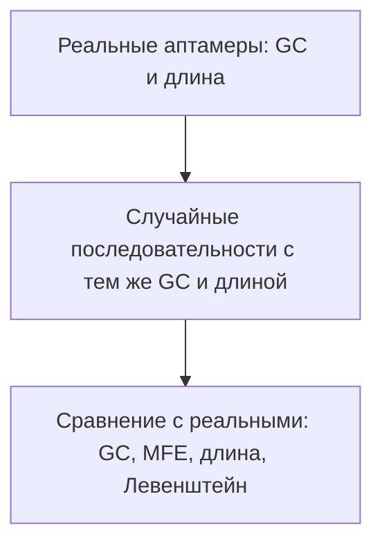
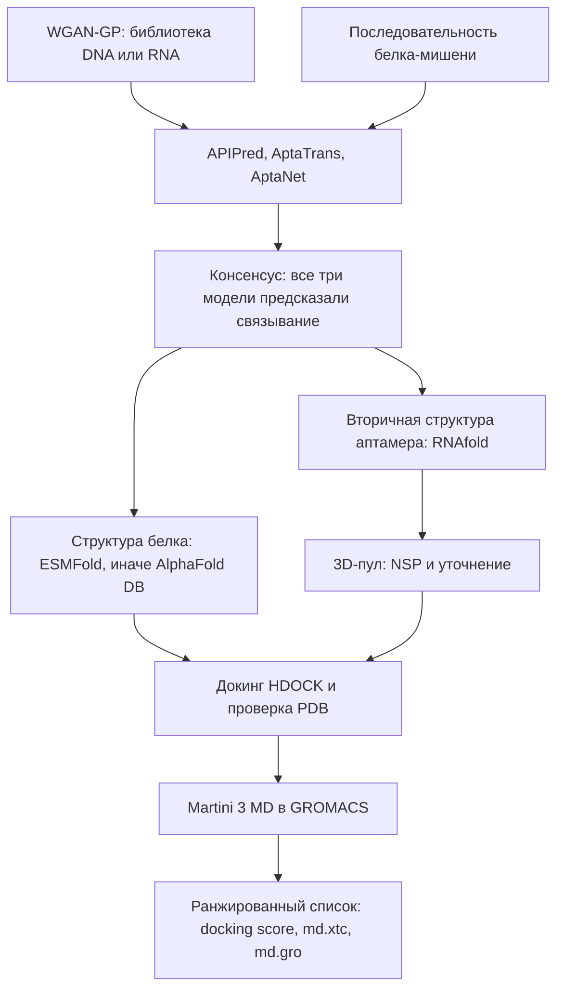

# ML System Design Doc

## Дизайн ML системы — in silico discovery аптамеров, MVP, итерация 1

Продукт — вычислительный пайплайн, который предлагает новые последовательности ДНК- и РНК-аптамеров и отбирает из них кандидатов на связывание с заданным белком до мокрого эксперимента.

### 1. Цели и предпосылки

#### 1.1. Зачем идем в разработку продукта?

Сейчас аптамеры ищут экспериментальным отбором SELEX: много раундов синтеза, отбора и секвенирования. Это долго и дорого, а большая часть библиотеки до белка-мишени не доходит.

Генератор предлагает новые последовательности, похожие на известные аптамеры по составу и локальным мотивам, но не копирующие их. Дальше in silico-валидация оставляет только те пары «аптамер — белок», которые проходят согласие трёх моделей связывания, структурную проверку, докинг и короткую молекулярную динамику.

Успех итерации для бизнеса: на выходе есть ранжированный короткий список кандидатов с docking score и артефактами MD. По этому списку можно решать, какие последовательности синтезировать. Сам синтез и измерение аффинности в пробирке в эту итерацию не входят.

#### 1.2. Бизнес-требования и ограничения

Нужно для заданной белковой мишени получить библиотеку химически правдоподобных ДНК- или РНК-последовательностей и упорядочить её по вычислительным признакам связывания. Пользователь пайплайна — исследователь, который приносит последовательность мишени и забирает таблицу кандидатов.

Ограничения по сложности реализации:

- Размеченных пар «аптамер — белок» мало. Негативы для скрининга приходится собирать синтетически: случайные сочетания известных аптамеров и белков, которых нет в положительной выборке, 3 негатива на 1 позитив. Это не экспериментально подтверждённые несвязывающие пары, и классификатор на них легко переоценить.
- Привязать генератор к белку в этой итерации слишком дорого: он учится только распределению последовательностей. Отбор под мишень вынесен в отдельный каскад валидации.
- ДНК и РНК не собираются в одну модель. Алфавиты разные: `{A, C, G, T, X}` и `{A, C, G, U, X}`, `X` — паддинг. Длина в генераторе фиксирована: 80 позиций, хвост из `X` отрезается.
- Структурный блок трудно собрать и прогнать. ViennaRNA, ESMFold или AlphaFold DB, RNAfold, NSP, HDOCK, GROMACS, martinize2 и reForge в репозитории нет, их ставят отдельно. Обучение генератора и production-MD упираются в GPU.
- Полноатомная динамика всего шортлиста неподъёмна по времени. В этой итерации MD coarse-grained, силовое поле Martini 3.

От итерации ожидается воспроизводимый прогон двух частей репозитория: `Aptamer-Generation` и `Aptamer-Validation`.

Как этим пользуются в процессе: исследователь указывает мишень, пайплайн отсекает слабых кандидатов и отдаёт таблицу. Человек выбирает, что нести в эксперимент. В этой итерации эксперимент не запускается.

Пилот успешен, если выдержаны пороги качества:

- На мишень в шортлисте не больше 5 кандидатов с лучшим docking score среди прошедших проверку PDB. По этому списку решают, что синтезировать.
- У APIPred, AptaTrans и AptaNet на тестовой выборке F1 класса «связывается» не ниже 0.70 и ROC AUC не ниже 0.80. В консенсус входит пара, которую связыванием назвали все три модели.
- Из комплексов, дошедших до проверки PDB, её проходят не меньше 80%: в структуре есть атомы, у белка больше 50 атомов, у РНК больше 20. В MD уходят только они.

Пути развития: условная генерация под конкретный белок, дообучение генератора наградой из MD, полноатомная динамика, синтез топ-кандидатов и проверка связывания in vitro.

#### 1.3. Что входит в скоуп проекта/итерации, что не входит

В эту итерацию входит:

- Обучение WGAN-GP для ДНК и РНК и генерация библиотеки последовательностей.
- Контроль генерации по GC-составу, MFE (ViennaRNA), средней длине и расстоянию Левенштейна до ближайшей реальной последовательности.
- Скрининг пар «аптамер — белок» тремя моделями: APIPred, AptaTrans, AptaNet. В консенсус попадает пара, только если все три предсказали класс «связывается».
- Структура белка (ESMFold, при неудаче — AlphaFold DB), вторичная структура аптамера (RNAfold), пул 3D-моделей (NSP и уточнение).
- Докинг HDOCK, проверка PDB (в комплексе есть атомы; белок больше 50 атомов, РНК больше 20) и coarse-grained MD в GROMACS.
- Сводные таблицы `candidates_for_docking.csv` и `final_ranked_candidates_hdock.csv`.

В эту итерацию не входит:

- Синтез и лабораторный анализ (EMSA, SPR).
- Обучение генератора на награду из docking score или MD.
- Генерация, обусловленная последовательностью белка.
- Полноатомная MD (AMBER/CHARMM).
- Сервис с API, очередью задач и SLA.

Код итерации — исследовательские скрипты и Snakemake, не устанавливаемый пакет. Стиль Python проверяют Ruff и pre-commit, правила лежат в `pyproject.toml` и описаны в `CONTRIBUTING.md`. Фиксированные сиды есть в генерации и в `preprocess_and_split.py` (`random_state=42`). Отдельного окружения со всеми научными бинарниками в репозитории нет.

Технический долг, который оставляем до продуктивизации:

- Сгенерированная библиотека и валидация ещё не склеены одним входом. Генератор пишет веса и отчёт в `Aptamer-Generation`. Валидация стартует с `Aptamers_and_targets.csv`, то есть с известных пар, а не с новых последовательностей.
- `Snakefile` не проходит Ruff: это Snakemake, не чистый Python.
- Внешние модели и бинарники ставятся вручную.
- Негативы для классификаторов — синтетические пары. Precision на таком негативном классе завышает реальную избирательность.

#### 1.4. Предпосылки решения

Единица решения — одна последовательность аптамера против одной белковой мишени. Система сокращает экспериментальный перебор перед синтезом.

Какие данные используем:

- Для генератора — последовательности реальных аптамеров, файлы `Aptamer-Generation/data/train_dna_dataset.csv` и `train_rna_dataset.csv`. Модель учится распределению последовательностей, отдельной метки связывания у генератора нет.
- Для скрининга — пары `apt_seq`, `target_seq` и имя мишени. Позитивная пара — известное связывание. Негативная пара собирается случайным сочетанием аптамера и белка, которого нет среди позитивов. РНК и ДНК делятся по наличию `U` в последовательности аптамера.
- Для структуры и динамики — аминокислотная последовательность мишени, последовательность аптамера, вторичная структура в dot-bracket, PDB комплекса.

Гранулярность моделей разная, и это заложено в схему:

- Генератор выдаёт последовательность до 80 символов из шума размерности 64. Он не знает мишень.
- Три модели скрининга оценивают пару целиком и отдают вероятность класса «связывается».
- Докинг и MD оценивают уже конкретную 3D-конформацию этой пары. У одного аптамера несколько конформеров, у каждого свой docking score.

Порог консенсуса жёсткий: внутреннее пересечение положительных предсказаний трёх моделей. Одна уверенная модель кандидата в докинг не пропускает. Так мы меняем полноту на меньший список для дорогих структурных шагов.

### 2. Методология

#### 2.1. Постановка задачи

Система решает две связанные задачи.

1. Генерация. Генерация дискретных последовательностей. WGAN-GP с градиентным штрафом (`λ = 10`), сэмплирование через Gumbel-Softmax, штраф за расхождение частот 2-меров и 3-меров (`α = 2`, `β = 5`) и энтропийная регуляризация (`γ = 0.05`). Критик оценивает расстояние между реальными и сгенерированными последовательностями.
2. Отбор под мишень. Каскад фильтров: классификация связывания, затем ранжирование структур. Классификаторы сравниваются по accuracy, ROC AUC, precision, recall и F1 класса «связывается». В структурном блоке кандидат ранжируется по docking score HDOCK. В MD уходит только комплекс, прошедший проверку PDB.

Бейзлайн — простой референс, с которым сравнивают генератор: случайные последовательности с тем же GC-составом и той же длиной, что у реальных аптамеров. Сравнение идёт по GC, MFE, длине и расстоянию Левенштейна до ближайшей реальной последовательности. WGAN-GP в бейзлайн не входит.

MVP — WGAN-GP плюс отбор под мишень: консенсус трёх моделей, фолдинг, докинг и Martini 3 MD. Целевые значения на тестовой выборке: F1 класса «связывается» не ниже 0.70 и ROC AUC не ниже 0.80 у каждой из трёх моделей. На мишень в шортлисте не больше 5 кандидатов, прошедших проверку PDB.

#### 2.2. Блок-схема решения

Бейзлайн — случайные последовательности без модели и без белка. MVP начинается с WGAN-GP и добавляет отбор под мишень.

Бейзлайн:

MVP, генерация плюс `Aptamer-Validation`:

Порядок MVP совпадает с шестью блоками `Aptamer-Validation`: скрининг и консенсус, фолдинг белка, вторичная структура, 3D-модель аптамера, докинг, coarse-grained MD. Сводка докинга пишется в `final_ranked_candidates_hdock.csv`. Траектория и финальная структура MD — `md.xtc` и `md.gro`.

#### 2.3. Этапы решения задачи

Цифры ниже из таблиц репозитория. Ноутбук `eda/aptamer_eda.ipynb`, скрипт `eda/run_eda.py`, сводка `eda/eda_summary.json`, картинки в `eda/figures/`.

##### Этап 1. Подготовка данных

Генератор видит уникальную последовательность аптамера. Скрининг видит пару "аптамер - белок" и метку: 1, если пара связывается, 0 если нет. Докинг и MD видят уже 3D-конформер этой пары.

| Данные | Где лежат | Откуда брать | Качество проверено |
| --- | --- | --- | --- |
| Пары DNA: `apt_seq`, `target_seq`, `label` | `Aptamer-Generation/data/train_dna_dataset.csv`, 2486 строк | статический файл в репозитории | да, этот EDA |
| Пары RNA | `train_rna_dataset.csv`, 1804 строки | статический файл в репозитории | да, этот EDA |
| Шортлист консенсуса | `Aptamer-Validation/docking_candidates/candidates_for_docking.csv` | прогон трех моделей скрининга | да, первая строка файла битая |
| Docking score | `docking_results/final_ranked_candidates_hdock.csv` | прогон HDOCK | да |
| Исходный каталог `Aptamers_and_targets.csv` | в репозитории нет | нужен скрипту `preprocess_and_split.py` | нет |
| Тестовые CSV после CD-HIT | скрипт пишет `test_dna_dataset.csv` и `test_rna_dataset.csv`, файлов нет | повторный запуск подготовки | нет |

Что в обучающих таблицах:

| | DNA | RNA |
| --- | ---: | ---: |
| Строк | 2486 | 1804 |
| Уникальных аптамеров | 285 | 286 |
| Уникальных белков | 335 | 333 |
| Метка 1 | 839 | 186 |
| Метка 0 | 1647 | 1618 |

Пустых последовательностей нет, дублей пар нет, одной и той же пары с двумя метками тоже нет. Белки записаны обычными аминокислотами. DNA-аптамеры состоят из A, C, G, T.

Что важно для модели:

- Позитивные RNA-пары сидят на 42 белках. Еще 291 белок встречается только с меткой 0: это 1420 строк из 1804, позитивов среди них нет. На оставшихся 384 строках доля метки 1 равна 0.484. Если разбить данные как попало, классификатор запомнит белок и почти не будет смотреть на аптамер.
- У DNA позитивные аптамеры в среднем длиннее: 74.8 против 52.4 у негативов. GC тоже выше: 0.574 против 0.525. Длина и состав уже разделяют классы.
- В `preprocess_and_split.py` задумано 3 синтетических негатива на 1 позитив. В файлах, которые лежат в репозитории, соотношение другое: 1.96 у DNA и 8.70 у RNA. Эти негативы никто не проверял в лаборатории.
- Генератор режет последовательность до 80 символов. Длиннее 115 DNA-строк и 179 RNA-строк.
- Белок длиннее 1000 аминокислот у 1381 DNA-пар и у 895 RNA-пар. ESMFold на таких часто не проходит, тогда берем AlphaFold DB.
- 21 DNA-аптамер без G и C, 20 из них с меткой 0. В RNA-таблице 42 строки с буквой T, хотя DNA/RNA делится по наличию U. 41 из них - негативы.
- У DNA 138 аптамеров ни разу не помечены как связывающие, но генератор берет все уникальные `apt_seq`.
- В шортлисте 29 пар. Первая строка файла - текст `cat candidates_for_docking.csv`, не заголовок. У двух строк нет имени мишени и `true_label = 0`. Вероятности APIPred и AptaTrans везде 1.0. 19 аптамеров шортлиста уже есть в RNA-обучении. В докинге 123 модели и 25 кандидатов, четырех кандидатов в таблице нет. Медиана docking score -396.27. Лучший score не выше -1000 только у трех кандидатов.

Откуда данные. Регулярной поставки нет. Каталог пар кладется один раз. `preprocess_and_split.py` оставляет уникальные пары как позитивы, добирает негативы случайными сочетаниями, делит DNA и RNA по букве U и режет train/test кластерами CD-HIT. Генератор потом читает готовый train CSV и берет уникальные последовательности. Шортлист и docking score - результат одного прогона валидации. Исходного каталога и тестовых CSV в репозитории нет, поэтому это разбиение из текущих файлов не повторить.

RNA-позитивов 186, DNA-позитивов 839. Чтобы RNA догнала DNA по числу позитивов, не хватает примерно 650 подтвержденных пар. Этого мало, пока нет лабораторных негативов: сейчас все нули синтетические. Имеет смысл добирать несвязывающие пары на тех же белках, где позитивы уже есть, а не подмешивать новые случайные белки.

Имен, контактов и историй пациентов в таблицах нет. Есть последовательности и названия мишеней, в том числе вирусные белки. Обезличивать нечего. На выходе все равно расчетный список для исследователя, не медицинское заключение.

Результат этапа - проверенные train-таблицы и ноутбук `eda/aptamer_eda.ipynb`. На честную проверку скрининга идут белки, у которых в данных есть обе метки. В генератор не кладем строки с чужим алфавитом. Белки длиннее 1000 аминокислот помечаем как риск для фолдинга. Шортлист читаем со строки заголовка `apt_seq`, первую битую строку пропускаем.

Для бейзлайна метка пары не нужна: случайные последовательности строятся по GC и длине реальных аптамеров. Для MVP нужны и уникальные аптамеры (WGAN-GP), и пары с меткой (три модели скрининга).

##### Этап 2. Подготовка прогнозных моделей

Генерация последовательности и оценка пары - разные модели. У них разные потери, разные выборки и разные метрики.

**Бейзлайн.** Случайная последовательность той же длины и с тем же GC, что у реального аптамера. Обучения нет. GC и длина совпадут сами по себе, это проверка сэмплера. Сравнивать имеет смысл MFE (ViennaRNA) и Левенштейн до ближайшей реальной последовательности. WGAN-GP должен дать MFE ближе к реальным данным и при этом не свалиться в копирование: расстояние порядка 20, как уже видно у текущего генератора. F1 у бейзлайна нет, метки связывания у него нет.

**MVP, генератор.** WGAN-GP, как в модуле генерации. Потеря критика - расстояние Вассерштейна и градиентный штраф, `λ = 10`. Потеря генератора - минус оценка критика, MSE частот 2-меров и 3-меров (`α = 2`, `β = 5`) и минус энтропия (`γ = 0.05`). Gumbel-Softmax нужен, потому что буквы дискретные. K-mer loss держит короткие мотивы, энтропия не дает схлопнуться в одну строку. Смотрим те же метрики, что у бейзлайна, плюс GC. Уже посчитано: GC DNA 0.536 при 0.525 у реальных, RNA 0.537 при 0.534. MFE слабее реальных: -8.26 против -12.13 у DNA и -9.17 против -10.54 у RNA. Левенштейн 20.15 и 21.96. Эти числа сняты на тех же последовательностях, на которых модель училась. Для решения нужен такой же отчет на отложенных аптамерах.

**MVP, скрининг.** APIPred, AptaTrans и AptaNet дают вероятность класса "связывается". В текущем скрипте AptaNet считается через XGBoost, не через исходную нейросеть. Порог на тесте: F1 класса "связывается" не ниже 0.70 и ROC AUC не ниже 0.80 у каждой модели. F1 нужен, потому что ложный позитив потом идет в докинг. ROC AUC нужен из-за дисбаланса: у RNA негативов в 8.7 раза больше, чем позитивов. Accuracy в отчет пишем, но порогом не ставим: на полной RNA-таблице ее раздувают 1420 легких негативов. В `benchmark_summary.json` рядом с accuracy и classification report пишется `roc_auc`.

**Как валидируем.** Горизонта по времени нет, это не прогноз на дату. Пересчитываем модель, когда появляется новая пачка лабораторных пар. Строки случайно не режем: 2486 DNA-строк собраны из 285 аптамеров, один белок бывает и в позитивах, и в негативах. В `preprocess_and_split.py` уже есть нарезка CD-HIT по аптамеру и по белку, но тестовые файлы в репозиторий не положили. Для скрининга отчет делаем два раза: на кластерном тесте и отдельно на белках, у которых есть обе метки. Для RNA это 384 строки, позитивов там 0.484. Для генератора в отложенную часть кладем целые аптамеры, не отдельные строки пар. В пилот идет модель, которая прошла порог на таком срезе.

**Что делать дальше.** Сначала нормальное разбиение, потом уже гиперпараметры. У классификаторов проверяем, не держится ли качество на длине, GC и id белка: считаем ту же модель без этих признаков. Вероятности надо калибровать. Сейчас на шортлисте APIPred и AptaTrans везде 1.0, внутри консенсуса они никого не сортируют, остается AptaNet. Редкие белки схлопываем в одну категорию. У генератора следующий шаг - подтянуть MFE к реальным данным и не уронить Левенштейн.

**Как смотрим, что модель делает.** У генератора сравниваем частоты 2-меров и 3-меров, GC, MFE и длину с реальными аптамерами и со случайным бейзлайном. У скрининга ошибки смотрим по длине аптамера, длине белка и по тому, был ли у этого белка позитив в обучении. Исследователь до синтеза смотрит топ-5 на мишень. Если в топ попала последовательность из train, это не обобщение: 19 из 29 текущих кандидатов как раз из RNA-обучения.

**Где можем ошибиться.** Синтетические негативы завышают качество. RNA-модель может выучить белок, а не аптамер. У DNA длина аптамера и так разделяет классы. Вероятности, застывшие на 1.0, превращают консенсус в голосование. Генератор, проверенный на своих обучающих строках, выглядит разнообразнее, чем он есть. Лечится тем же разбиением: кластерный тест, отдельный отчет по белкам с обеими метками, калибровка, сравнение MFE с бейзлайном.

Результат этапа: `benchmark_summary.json` с `roc_auc` и отчет генератора против случайных последовательностей на отложенных аптамерах. К докингу идем, если каждая из трех моделей на кластерном тесте и на белках с обеими метками держит F1 не ниже 0.70 и ROC AUC не ниже 0.80.

##### Этап 3. Консенсус под мишень

У случайного бейзлайна белка нет, поэтому на этом шаге он не участвует. В MVP пара идет дальше, только если все три модели сказали "связывается". Одной высокой вероятности мало.

На текущем прогоне после консенсуса 29 пар, 27 из них с `true_label = 1`. Две строки без имени мишени помечены как негативы, в структуру их не кладем. APIPred и AptaTrans на этом списке всех оценивают одинаково. Файл читаем с заголовка `apt_seq`: первая строка сейчас лишняя.

Результат этапа: `candidates_for_docking.csv` и папка кандидата с FASTA аптамера и белка. Проверка простая: в списке узнаваемые мишени и нет пар, которые хотя бы одна модель не поддержала.

##### Этап 4. Структура, докинг и шортлист для синтеза

Для каждой пары из этапа 3: структура белка через ESMFold, если не вышло - AlphaFold DB; вторичная структура аптамера через RNAfold; пул 3D-моделей через NSP; докинг HDOCK; проверка PDB; для прошедших - Martini 3 MD в GROMACS.

По текущим данным примерно половина белков длиннее 1000 аминокислот, так что отказ ESMFold будет частым. Из 29 кандидатов консенсуса до таблицы докинга дошли 25, по 3-9 конформеров, всего 123 модели. Четыре кандидата отвалились раньше. Docking score от -1246.21 до -244.95, медиана -396.27. В MD попадает комплекс, где есть атомы, белок больше 50 атомов и РНК больше 20. Порог пилота: так проходят не меньше 80% задоченных комплексов.

Внутри мишени сортируем по docking score. На синтез смотрим не больше 5 кандидатов. Случайные последовательности сюда не гоняем, комплекса у них нет. Имеет смысл рядом положить топ-5 по вероятности AptaNet и топ-5 по docking score: если списки разойдутся, в отчет идут оба.

Docking score и короткая Martini-траектория - не лабораторная аффинность. Длинный белок может выпасть на фолдинге, и шортлист станет короче. Это порядок кандидатов для эксперимента, не замена SPR или EMSA.

Результат этапа: `final_ranked_candidates_hdock.csv`, для прошедших PDB - `md.xtc` и `md.gro`, и не больше 5 кандидатов на мишень.
